# Báo cáo cá nhân — Ngày 2 Object Detection

## 1. Thông tin học viên

- Họ tên: Đoàn Quang Minh
- MSSV: 2A202603228
- Email: 26ai.minhdq6@vinuni.edu.vn
- Lớp: L2A
- Link repo bài làm: https://github.com/doanquangminh14/K5-L2-DAY02-DoanQuangMinh-2A202603228-ObjectDetection
- Link Colab đã chạy: https://colab.research.google.com/drive/1n_cGWA7VVTZv5ED5n5-yS5jb9I70Lbfi

## 2. Schema và mini guideline

Guideline chi tiết ở [GUIDELINE_MINI.md](../../GUIDELINE_MINI.md). Mình giữ schema theo README: `car=0`, `truck=1`, `bus=2`, `van=3`. Mỗi xe một box ôm sát phần nhìn thấy; xe bị che hoặc cắt mép vẫn gán nếu còn nhận ra loại xe.

Ba ca mơ hồ đã ghi trong guideline:

- `drive_001` : Xe con bị cột đèn chắn ngang thân: vẽ một box bao cả hai phần, vì đó vẫn là một xe.
- `drive_026`: hàng xe nối đuôi nhau, che nhau một phần: mỗi xe một box riêng, box được phép chồng nhau.
- `drive_029`: xe buýt bị xe con che khoảng một nửa: vẫn gán `bus` cho phần nhìn thấy và vẽ thêm box `car` riêng.

Phần cần giảng viên làm rõ:

- Gold không gán nhiều xe đỗ ven đường và xe rất nhỏ ở xa, trong khi README ghi "xe đang đỗ vẫn là `car`".
- Trong nhãn eval, các xe buýt thành phố lớn được gán `van` (xem `drive_052`, `drive_053`, `drive_060` trong ảnh nhãn eval), trong khi theo README thì xe buýt là `bus`. Mình gán theo README nên lệch với gold ở lớp `bus`/`van`.

## 3. Annotation và self-QC

- Số file nhãn train: 50, gán bằng CVAT, xuất định dạng YOLO 1.1.
- Kết quả checker: `ĐẠT cấu trúc: 50/50 file nhãn hợp lệ`. Khi chép nhãn mới, Windows đổi tên file thành `drive_001 (2).txt`, `(3)`, `(4)` vì trùng tên file cũ. Mình đổi tên lại bằng PowerShell và kiểm tra đủ 50 file tên chuẩn trước khi chạy checker.
- 10 ảnh đã rà bằng mắt: `drive_001`, `drive_004`, `drive_008`, `drive_009`, `drive_010`, `drive_012`, `drive_013`, `drive_014`, `drive_016`, `drive_018`.
- Lỗi phát hiện khi rà và cách sửa:
  - `drive_001`: box quá rộng, kéo lại sát thân xe.
  - `drive_014`: xe sát mép dưới ảnh chưa có box, vẽ thêm.
- Commit khóa nhãn ban đầu: `fbcc910` (Lock initial labels).

## 4. Gold QC và rework

| Chỉ số | Trước sửa | Sau sửa (vòng 4) |
|---|---:|---:|
| TP | 398 | 430 |
| FP | 395 | 270 |
| FN | 255 | 223 |
| Precision | 0.5019 | 0.6143 |
| Recall | 0.6095 | 0.6585 |
| F1 | 0.5505 | 0.6356 |
| mean_iou_of_matches | 0.7431 | 0.7492 |
| passed (theo ngưỡng mặc định của script, F1 ≥ 0.80) | false | false |

File kết quả: `outputs/annotation_evaluation.json` (bản sau sửa).

F1 qua các vòng sửa: 0.5505 → 0.5688 → 0.5973 → 0.6181 → 0.6356. Mean IoU luôn trên 0.70, nghĩa là các box đã khớp thì khá sát. Vấn đề chính là số lượng box: lần đầu mình vẽ 793 box trong khi gold có 653.

Mình so từng ảnh (số box gold, số box của mình, số box khớp) và vẽ ảnh đối chiếu nhãn của mình với gold để tìm lỗi:

- **Box thừa:** nhiều nhất ở `drive_001` (gold 5, mình 14, khớp đủ 5), `drive_002`, `drive_003`, `drive_018`, `drive_028`, `drive_044`. Phần lớn là xe đỗ ven đường và xe rất nhỏ ở xa. Mình xóa sau khi xem ảnh đối chiếu, ví dụ `drive_003` giảm từ 37 xuống 26 box.
- **Bỏ sót xe:** `drive_024`, `drive_026`, `drive_027`, `drive_041`. Mình vẽ thêm, `drive_024` tăng từ 9 lên 16 box khớp.
- **Chưa sửa được:** `drive_009` vẫn chỉ khớp 6/21 dù số box gần bằng gold. Vì evaluator chỉ ghép box cùng lớp, mình nghĩ nguyên nhân chính là lệch lớp `bus`/`van` như ở mục 2.

**Vì sao F1 chưa đạt 0.80.** Để tách lỗi vị trí box và lỗi phân lớp, mình chạy lại hàm `match` của `evaluate_annotations.py` nhưng bỏ điều kiện cùng lớp (chỉ để phân tích, không thay kết quả chính thức):

| | Ghép cùng lớp (chính thức) | Bỏ qua lớp |
|---|---:|---:|
| TP / FP / FN | 430 / 270 / 223 | 545 / 155 / 108 |
| F1 | 0.6356 | 0.8056 |
| mean IoU | 0.7492 | 0.7609 |

Có 115 box của mình trùng vị trí với gold (IoU ≥ 0.50) nhưng khác mã lớp. Gần như toàn bộ nằm ở nhóm xe lớn: box mình gán `bus` trùng với box gold mã `3` (52 box), `truck` trùng gold mã `2` (18 box), `car`/`van` trùng gold mã `1` (24 và 16 box). Trong nhãn của mình không có box `truck`, `bus` hay `van` nào cùng mã lớp với gold. Như vậy cách mình hiểu mã lớp cho xe lớn khác với cách gold dùng, và đây là phần lớn khoảng cách đến 0.80. Nếu chỉ xét vị trí box, F1 là 0.8056.

Phần còn lại (155 FP, 108 FN) là lỗi bao phủ: box thừa ở xe đỗ ven đường và xe nhỏ ở xa mà gold không gán, cùng các xe bị sót trong ảnh đông xe như `drive_026`, `drive_027`, `drive_041`. Nếu có thêm thời gian, mình sẽ đối chiếu lại cách gán mã lớp cho xe lớn trước, vì đó là phần ảnh hưởng nhiều nhất.

## 5. Kết quả YOLO

- Runtime: Google Colab, GPU Tesla T4 (15 GB), Ultralytics 8.4.208, Python 3.13.16, torch 2.14.1+cu130
- Tham số thay đổi so với notebook: không, chỉ điền `REPO_URL`
- Best checkpoint trong phiên chạy: `/content/Day2-Lab/outputs/yolo26_runs/vehicle_annotation/weights/best.pt` (không commit file `.pt`)

| Chỉ số trên 10 ảnh eval | Giá trị |
|---|---:|
| Precision | 0.409 |
| Recall | 0.234 |
| mAP50 | 0.271 |
| mAP50–95 | 0.200 |

Kết quả theo từng lớp:

| Lớp | Số xe trong eval | Precision | Recall | mAP50 | mAP50–95 |
|---|---:|---:|---:|---:|---:|
| car | 94 | 0.836 | 0.652 | 0.740 | 0.524 |
| truck | 5 | 0.663 | 0.200 | 0.240 | 0.206 |
| bus | 2 | 0 | 0 | 0.014 | 0.005 |
| van | 12 | 0.136 | 0.083 | 0.089 | 0.064 |

Ảnh và log:

Log train theo epoch: [results.csv](assets/yolo26_runs/vehicle_annotation/results.csv)

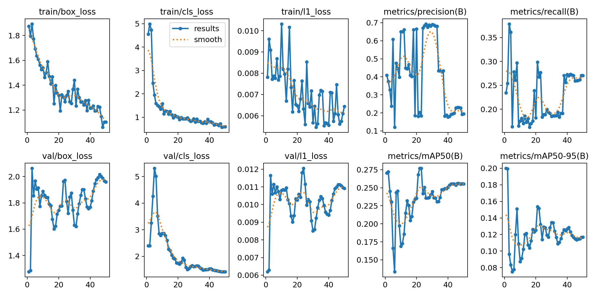

**Confusion matrix trên eval:**

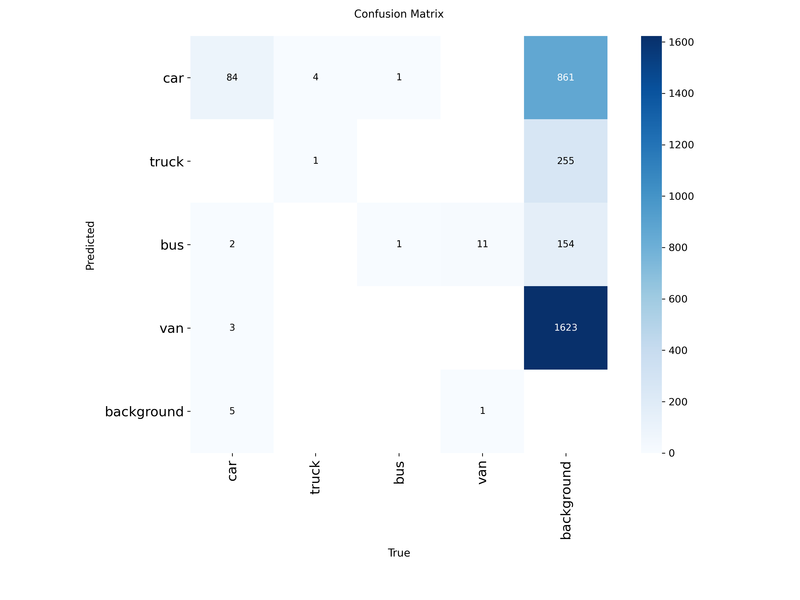

**Nhãn eval (trái) và dự đoán tương ứng (phải):**

<table>
  <tr>
    <td>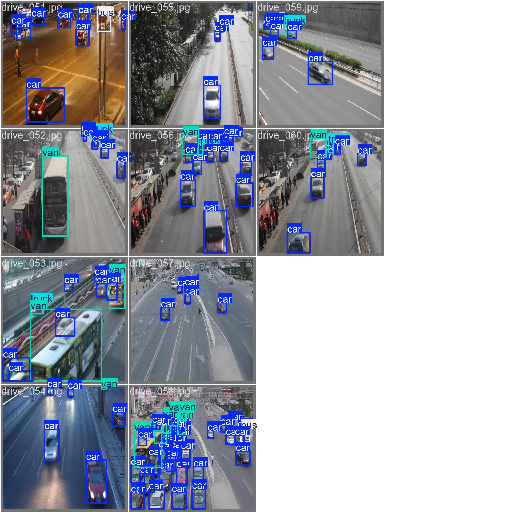</td>
    <td>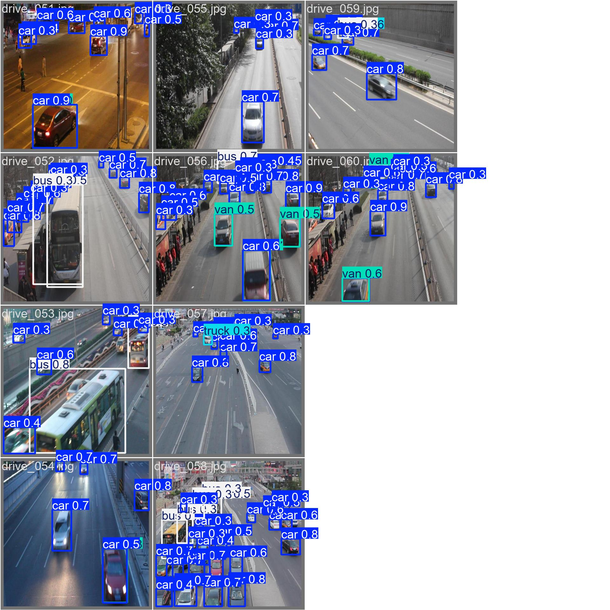</td>
  </tr>
</table>

**Ảnh dự đoán trên 10 ảnh eval:**

<table>
  <tr>
    <td>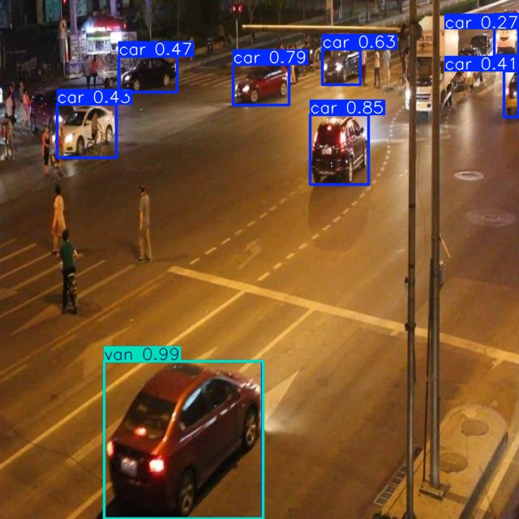 <code>drive_051</code></td>
    <td>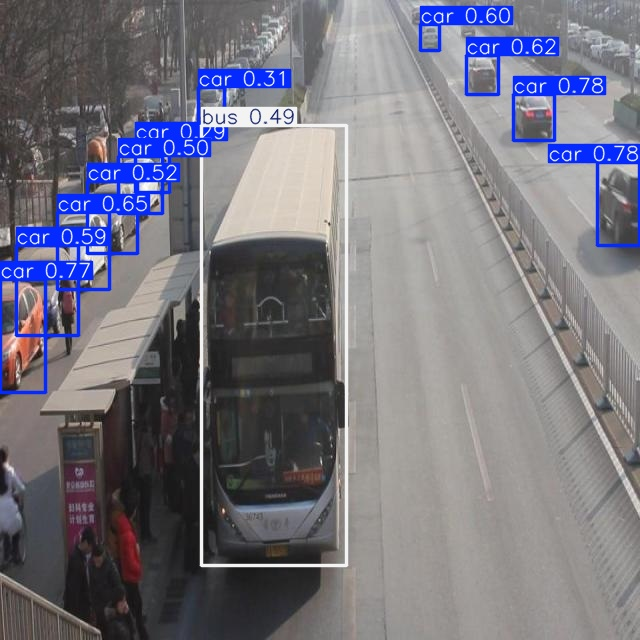 <code>drive_052</code></td>
  </tr>
  <tr>
    <td>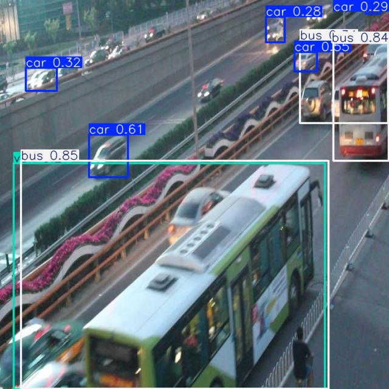 <code>drive_053</code></td>
    <td>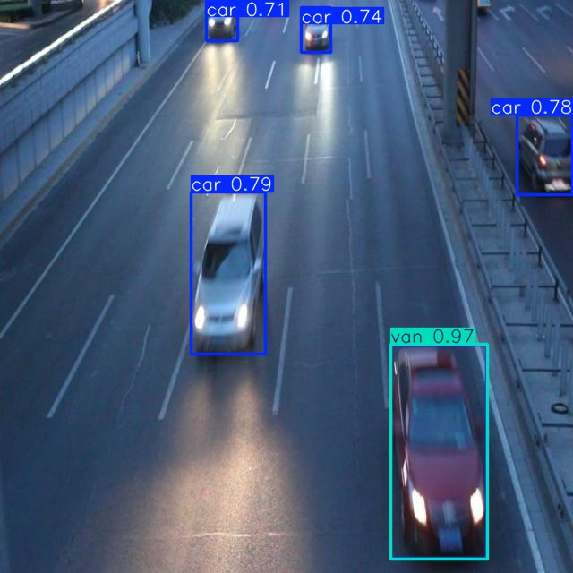 <code>drive_054</code></td>
  </tr>
  <tr>
    <td>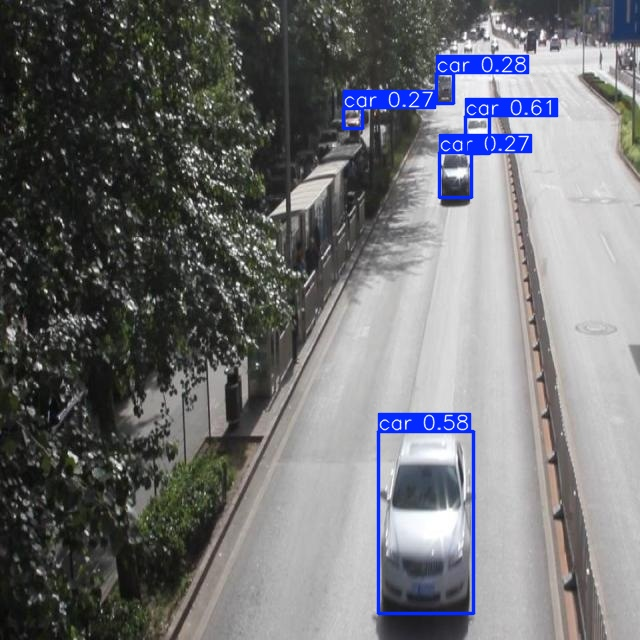 <code>drive_055</code></td>
    <td>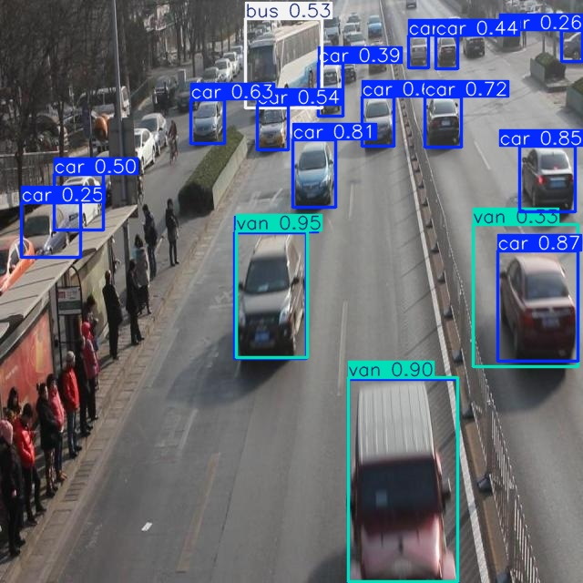 <code>drive_056</code></td>
  </tr>
  <tr>
    <td>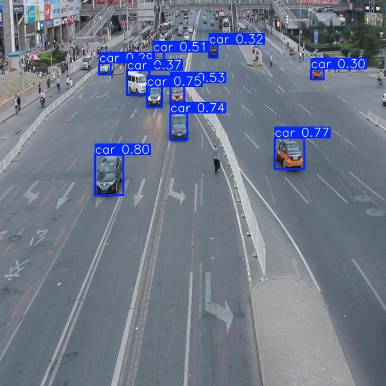 <code>drive_057</code></td>
    <td>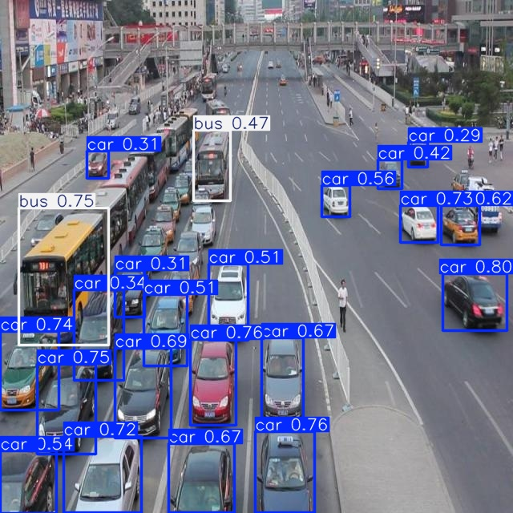 <code>drive_058</code></td>
  </tr>
  <tr>
    <td>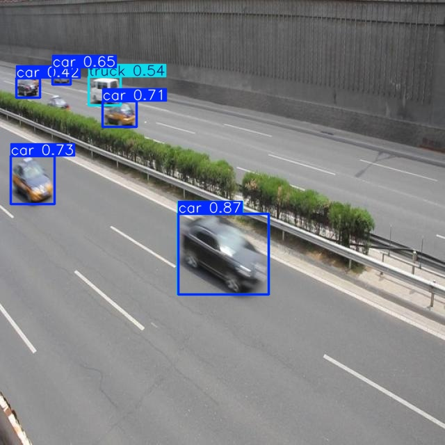 <code>drive_059</code></td>
    <td>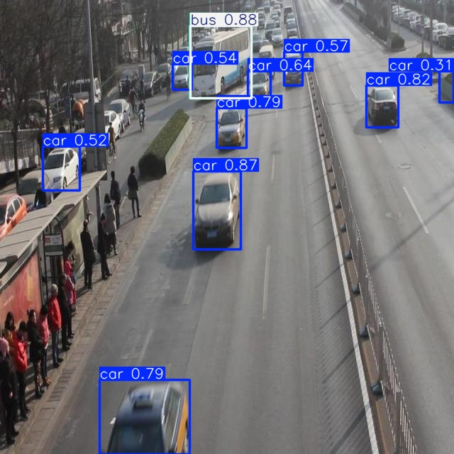 <code>drive_060</code></td>
  </tr>
</table>

**Ví dụ cụ thể, ảnh [`drive_052`](assets/eval_predictions/visuals/drive_052.jpg):** xe buýt hai tầng ở giữa ảnh có nhãn eval mã `3` (`van`), còn model dự đoán một box `bus 0.49` bao khá sát thân xe. Vì evaluator chỉ ghép box cùng lớp, xe này bị tính hai lần: một FN cho `van` và một FP cho `bus`, dù vị trí box gần đúng. Đây là cùng kiểu lệch mã lớp ở nhóm xe lớn mà mình thấy ở phần Gold QC. Các xe con đỗ dọc lề trái và trên làn bên phải được model nhận `car` với score 0.31–0.78.

Trả lời bốn câu hỏi cuối notebook:

1. **Lớp nào recall thấp nhất? Ảnh nào minh họa?**
   Thấp nhất là `bus` (recall 0) và `van` (0.083). Eval chỉ có 2 xe `bus` nên con số của `bus` không đủ tin cậy; `van` có 12 xe nên đáng chú ý hơn. Confusion matrix cho thấy 11/12 xe có nhãn `van` bị model dự đoán là `bus`. Ảnh minh họa là `drive_052` và `drive_053`: các xe được gán `van` trong nhãn eval là xe buýt lớn, và model đều dự đoán `bus` (ở `drive_053` là `bus 0.85`).

2. **Nếu mAP50 cao nhưng mAP50–95 thấp, cần kiểm điều gì trên box?**
   Với `car`, mAP50 là 0.740 nhưng mAP50–95 chỉ 0.524: model tìm ra xe nhưng box chưa sát, nên khi yêu cầu IoU cao hơn thì điểm giảm mạnh. Cần kiểm tra box có lỏng, lệch hay bị trùng không. Trên ảnh có trường hợp hai box cho cùng một xe, ví dụ xe đỏ bên phải `drive_056` có cả `car 0.87` và `van 0.33`. Cũng cần xem lại nhãn train: mean IoU giữa nhãn của mình và gold chỉ 0.749, nên box trong dữ liệu train cũng chưa thật sát, và model học theo.

3. **Lỗi class nào có thể liên quan guideline? Dữ kiện nào hỗ trợ nhận xét?**
   Rõ nhất là `bus`/`van`. Confusion matrix có 11 xe nhãn `van` bị dự đoán `bus`, và ảnh nhãn eval cho thấy đó là xe buýt thành phố (`drive_052`, `drive_053`, `drive_060`). Mình gán nhãn train theo README (xe buýt là `bus`), nên model học đúng theo README nhưng lệch với nhãn eval. Đây là vấn đề định nghĩa lớp giữa guideline và bộ gold, không phải lỗi riêng của model. Ngoài ra, 4/5 xe `truck` bị dự đoán `car`, và ở `drive_056` một xe SUV có nhãn `car` bị dự đoán `van 0.95`. Guideline cần tiêu chí rõ hơn để phân biệt SUV, minivan và van; tập train cũng có rất ít `truck`, `bus`, `van` so với `car`.

4. **Vì sao không dùng 10 ảnh eval để train? Vai trò validation của chúng trong notebook là gì?**
   Eval dùng để đo model trên ảnh nó chưa từng học. Nếu đưa vào train, model đã thấy đáp án nên chỉ số sẽ cao giả và không phản ánh khả năng thật. Trong notebook, 10 ảnh eval còn làm tập validation để chọn `best.pt` sau mỗi epoch, nên chúng đã ảnh hưởng gián tiếp đến model và không phải test set độc lập.

## 6. Khó khăn và cách xử lý

| Bước/thời điểm | Lỗi quan sát | Cách đã thử | Kết quả/còn thiếu |
|---|---|---|---|
| Chép nhãn sau mỗi lần xuất | Windows đặt tên file mới thành `drive_001 (2).txt`, `(3)`, `(4)` nên evaluator vẫn đọc nhãn cũ | Đổi tên bằng PowerShell, kiểm tra đủ 50 file tên chuẩn | Đã xử lý |
| Gold QC | F1 0.5505, nhiều box thừa và bỏ sót | Sửa 4 vòng theo ảnh đối chiếu | F1 0.6356  |
| Lệch giữa README và gold | Gold bỏ nhiều xe đỗ ven đường; xe buýt lớn được gán `van` | Hỏi trên Discord; Lab Coach chấp nhận F1 ≥ 0.5 | Dùng ngưỡng 0.5 và ghi rõ trong báo cáo |

## 7. Tự đánh giá theo rubric

- Định dạng YOLO: checker đạt 50/50.
- Đầy đủ vật thể và độ bám sát box: mean IoU 0.749 nhưng recall 0.659, vẫn còn bỏ sót xe.
- Phân lớp: lệch `bus`/`van` so với gold; còn `drive_009` chưa sửa xong.
- Mini guideline: có định nghĩa 4 lớp, quy tắc box và 3 ca mơ hồ.
- Gold QC: đạt ngưỡng F1 ≥ 0.5 do Lab Coach thông báo, chưa đạt 0.80 theo tài liệu; có 4 vòng rework với số liệu từng vòng.
- Pipeline YOLO: Colab chạy được, giữ nguyên split, có metrics, ảnh eval và phân tích lỗi.

## 8. Công cụ AI và tài liệu tham khảo

Phần mình tự làm:

- Tự vẽ và sửa toàn bộ box trong 50 ảnh trên CVAT, qua 4 vòng rework.
- Tự chạy checker, evaluator và notebook Colab; mọi số liệu trong báo cáo lấy từ các lần chạy này.
- Tự quyết định các ca mơ hồ trong guideline và các nhãn cần xóa, thêm hoặc sửa sau khi đối chiếu với gold.
- Tự xem ảnh nhãn eval, ảnh dự đoán và confusion matrix để kiểm tra các nhận xét ở mục 5.

Phần dùng Claude (Anthropic) hỗ trợ:

- Hướng dẫn thao tác với CVAT, Git, PowerShell và Colab khi gặp lỗi.
- Góp ý cách diễn đạt guideline và báo cáo; gợi ý cách trình bày câu trả lời ở mục 5 dựa trên số liệu và ảnh của mình, sau đó mình đã đối chiếu lại với kết quả thực tế.